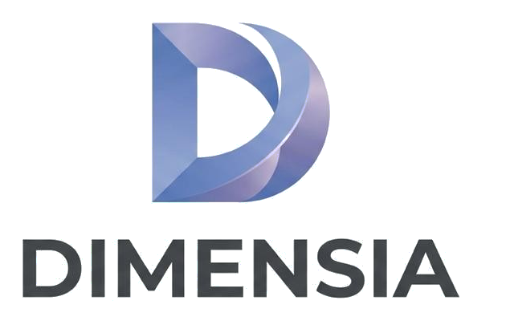
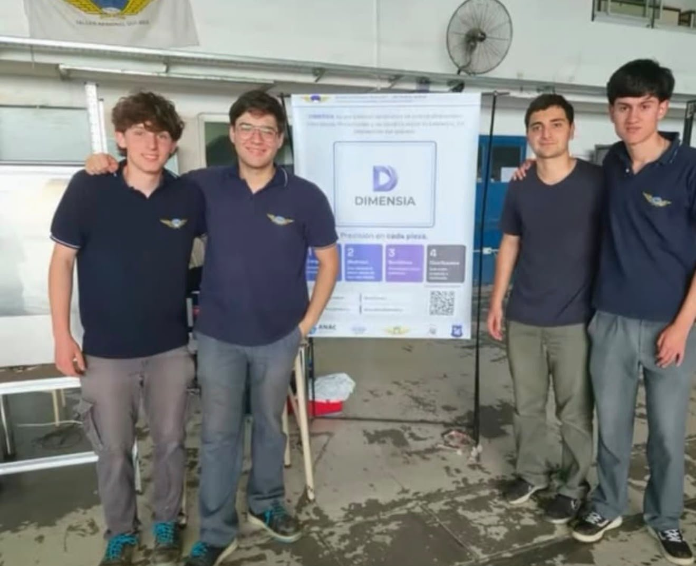
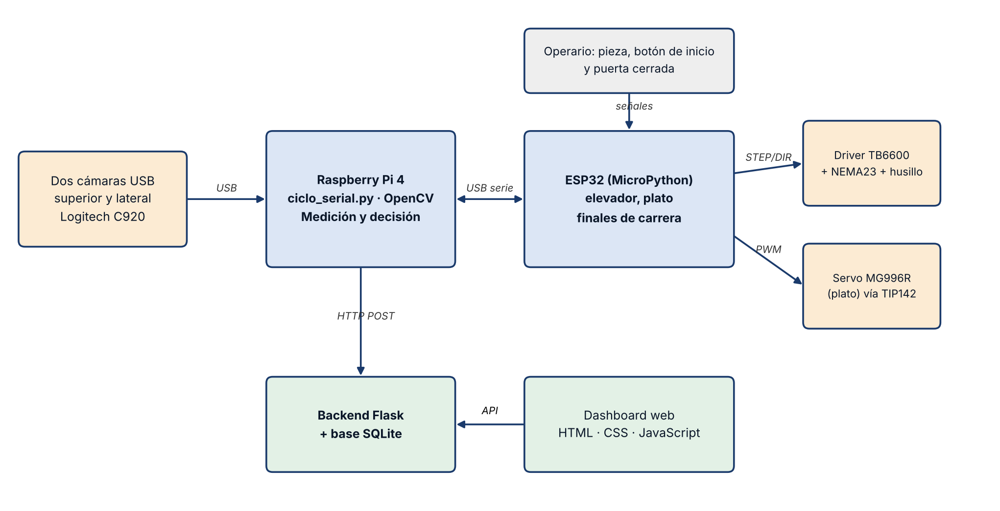
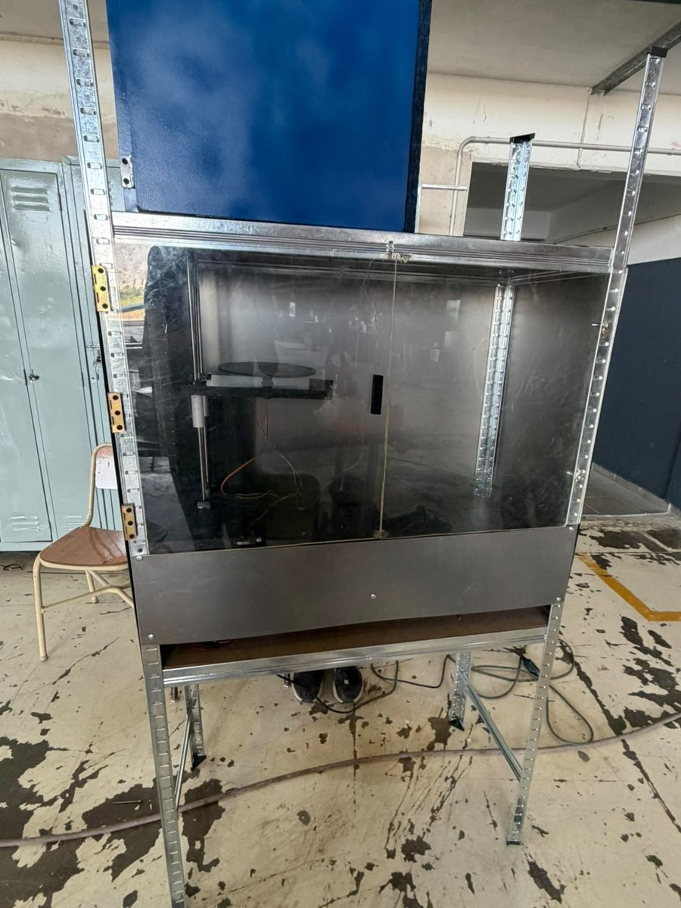
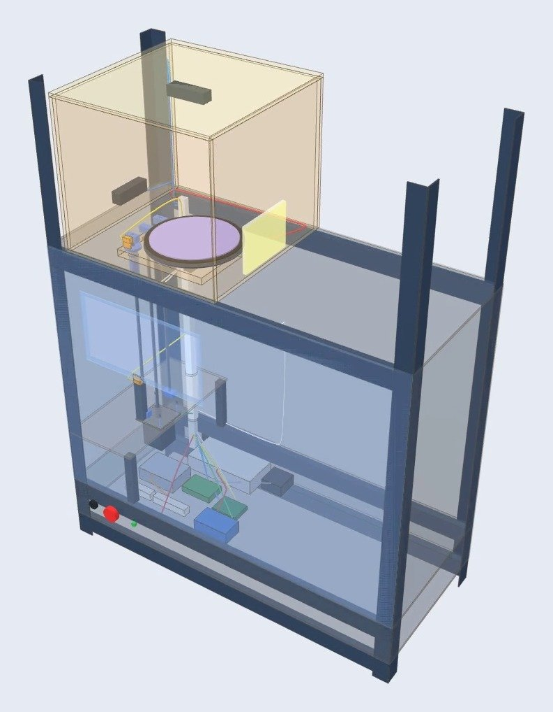
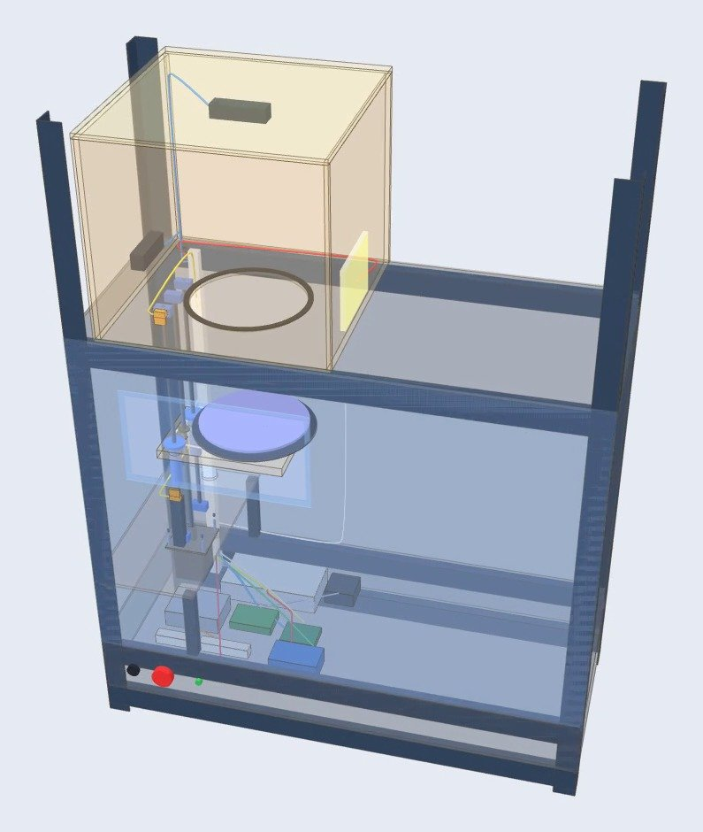
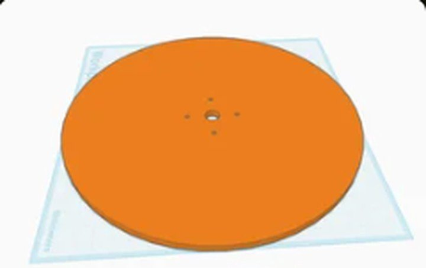
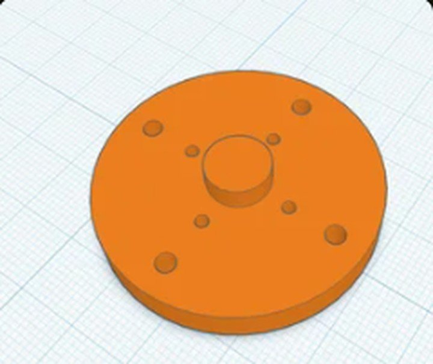
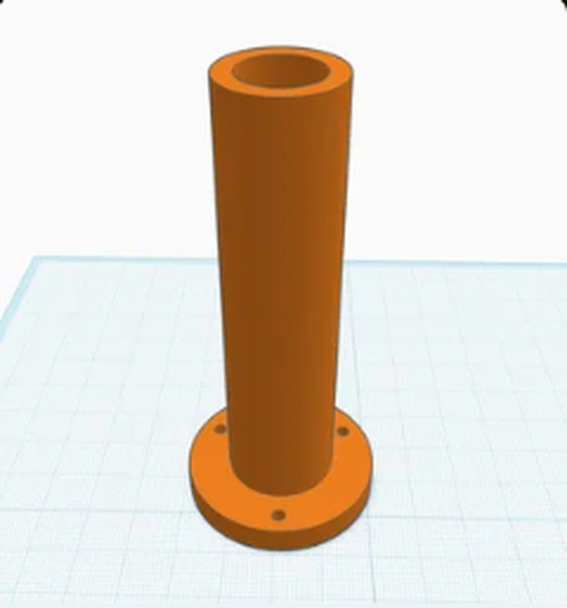
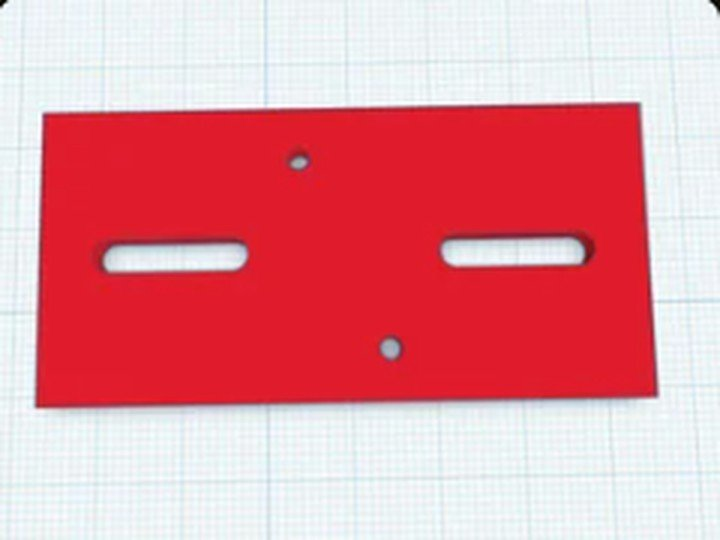

# [DIMENSIA](https://dimensia-web-1.vercel.app/)



| Página web | Email | Instagram | Gestión |
|---|---|---|---|
| [dimensia-web-1.vercel.app](https://dimensia-web-1.vercel.app/) | dimensiaimpa@gmail.com | [@dimensia.impa](https://www.instagram.com/dimensia.impa) | [Trello](https://trello.com/b/ZSbtVKM4/kanban-2026722bdimensia) |

### INSPECCIÓN DIMENSIONAL AUTOMATIZADA DE PIEZAS DE TORNERÍA

DIMENSIA es una estación que mide el alto, el ancho y el largo de piezas pequeñas de tornería (niples, uniones, codos y bridas) con dos cámaras y visión artificial con OpenCV. Compara cada pieza con su referencia y tolerancia, decide si queda **aprobada** o **rechazada**, y guarda la inspección con sus capturas para consultarla desde un dashboard web.

Proyecto final de la EET N°7 — Taller Regional Quilmes (IMPA TRQ), especialidad Aviónica, 2026.

<p align="center">
  
</p>

---

## Objetivo

Reemplazar el control manual con calibre por una inspección automática, repetible y con trazabilidad: cada pieza se mide desde distintos ángulos, el resultado no depende del operario y queda registrado el valor de cada dimensión, el motivo de rechazo y las imágenes capturadas.

## Cómo funciona

1. El operario apoya la pieza en el plato, cierra la puerta y presiona el botón de inicio.
2. Un motor paso a paso NEMA23 con husillo T8 sube el plato hasta la caja de medición.
3. Un servo gira el plato 8 veces de 45°. En cada parada, dos cámaras (superior y lateral) capturan la pieza.
4. La Raspberry Pi detecta la pieza y convierte píxeles a milímetros con el factor de calibración de cada cámara.
5. Se toma la **mediana de las 8 vistas** de cada dimensión y se compara con referencia ± tolerancia.
6. El resultado y las capturas se envían al backend y se muestran en el dashboard. El plato baja y el sistema queda listo para otra pieza.

La visión es clásica (segmentación por saturación, CLAHE, transformada de Hough, contornos). **No usa inteligencia artificial.**

<p align="center">
  
</p>

## Componentes del Proyecto

### Estación de medición
Estantería metálica con la caja de medición, el elevador (motor NEMA23, husillo T8 y dos varillas guía) y el plato de Ø204 mm. Las piezas especiales se diseñaron en Tinkercad y se imprimieron en 3D. Dos cámaras Logitech C920 (superior y lateral) capturan la pieza.

### Raspberry Pi 4
Coordina el ciclo: captura las imágenes, mide con OpenCV, toma la mediana de las 8 vistas, decide y envía el resultado al backend. Escrita en Python.

### ESP32
Mueve el elevador y el servo del plato, y lee los finales de carrera, la puerta y el botón de inicio. Escrita en MicroPython. Se comunica con la Raspberry por USB serie (115200 baudios) con mensajes de texto: `INICIAR`, `ARRIBA`, `PASO`, `PASO_OK`, `FIN APROBADA|RECHAZADA`, `LISTO`, `ERROR`, `ABORTAR`. Ver [`docs/ciclo-serial.md`](docs/ciclo-serial.md).

### Backend
API REST en Flask con base de datos SQLite. Guarda inspecciones, tipos de pieza, calibraciones y capturas (archivos JPG). Ver [`docs/api-backend.md`](docs/api-backend.md).

### Dashboard
Panel web en HTML, CSS y JavaScript: login de operario, inspección en vivo, tipos de piezas con tolerancias, historial con filtros, reportes con exportación a CSV, historial de calibraciones y alerta ante rechazos consecutivos.

### Electrónica
Fuente de 12 V para el driver del motor; reguladores a 6 V (servo) y 5 V (Raspberry Pi). Montaje en placa perforada.

---

## Proyecto terminado

<p align="center">
  
</p>

Caja de medición arriba y, abajo, la estantería con el elevador y el plato visibles a través del acrílico.

### Modelo 3D de la estructura

<p align="center">
  
  
</p>

Caja de medición arriba; abajo el elevador, la electrónica y el botón de inicio. A la izquierda el plato en reposo y a la derecha en la zona de medición.

### Piezas diseñadas e impresas en 3D

Diseñadas en Tinkercad e impresas en 3D.

<p align="center">
  
  
  
  
</p>

Plato giratorio, adaptador del servo al plato, tubo del carro del elevador y soporte del final de carrera.

---

## Estructura del Proyecto

**docs/**  Documentación: protocolo serie, API del backend, historias de usuario e imágenes.  
**esp32/**  Firmware en MicroPython: elevador, servo del plato y comunicación serie.  
**raspberry/**  Ciclo de inspección, cámaras, segmentación, calibración y envío al backend.  
**css/**, **js/**, **index.html**  Dashboard web.  
**app.py**, **database.py**  Backend Flask y acceso a la base de datos SQLite.

---

## Calibración (píxeles a milímetros)

Cada cámara tiene un factor de escala en px/mm: se mide en píxeles una pieza patrón de medidas conocidas y se divide por sus milímetros reales. Luego `mm = píxeles ÷ factor`. Si una cámara se mueve hay que recalibrar.

```bash
cd raspberry
python calibrar_caja.py --alto-mm 57 --ancho-mm 34 --guardar
```

## Cómo correr el proyecto

**Backend**

```bash
pip install flask flask-cors
python app.py
```

Servidor en http://127.0.0.1:5000 (en Windows, `py app.py`).

**Dashboard**, desde su carpeta:

```bash
python -m http.server 8001
```

Abrir http://127.0.0.1:8001. La dirección del backend está en la constante `API` de `js/main.js` (y en el login); si el backend corre en otra computadora, poner su IP.

**Raspberry Pi**

```bash
cd raspberry
python ciclo_serial.py                              # ciclo con botón físico
python ciclo_serial.py --iniciar                    # inicio con ENTER
python ciclo_serial.py --sin-serial --sin-enviar    # prueba de escritorio
```

La IP del backend se define en `raspberry/config.py` (o en `config_local.py`, no versionado).

---

## Alcance y trabajo futuro

El prototipo mide y clasifica cada pieza como aprobada o rechazada en el software y el dashboard. Quedaron fuera del alcance: la separación física de piezas (plataforma basculante y brazo empujador, diseñados pero no construidos; `esp32/servo_brazo.py` y `esp32/servo_paleta.py` quedan como base), la placa de circuito impreso, un estudio estadístico formal del error de medición (la resolución teórica es de un píxel: ≈0,19 mm en la cámara superior y ≈0,15 mm en la lateral) y la publicación del backend en un servidor.

## Equipo

**Valentino Mendieta Insfrán** — Backend, base de datos, dashboard y coordinación  
**Gino Orciani** — Raspberry Pi, OpenCV, cámaras y firmware ESP32  
**Luciano Algozzino** — Estructura física y electrónica  
**Joaquín Korylkiewicz** — Estructura física y electrónica
